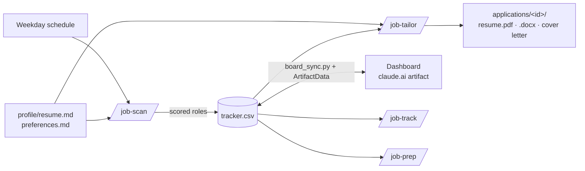

# jobhunt-agent

A job-search agent built on [Claude Code](https://claude.com/claude-code). It scans job boards every weekday, scores each role against your resume, tailors your resume and cover letter for a specific job without inventing anything, tracks your applications, and preps you for interviews. A live dashboard shows your pipeline, including on your phone.

I built it for my own senior Flutter job search. It works for any role: everything it knows about you comes from two markdown files.

## What it does

| Command | What happens |
|---|---|
| `/job-scan` | Searches LinkedIn, regional job boards and remote boards for roles posted in the last 7 days. Opens each posting to confirm it's real and still open, scores it 0–100 for fit (stack, seniority, location, domain, salary), and adds the good ones to your tracker. |
| `/job-tailor <id or link>` | Saves the posting, writes a fit analysis (each requirement marked matched, partial or gap, quoting your resume), builds a tailored resume as PDF and Word, and writes a cover letter under 250 words. |
| `/job-track` | "I applied to X", "rejected by Y", "interview Tuesday": updates the pipeline, sets follow-up dates, and lists what's due. |
| `/job-prep <id>` | Company research, likely questions with STAR outlines from your real experience, a technical drill for the job's stack, and a live mock interview. |

A scheduled task runs the scan every weekday morning.

## Ground rules it follows

- **It never invents experience.** Every line in a tailored resume traces back to `profile/resume.md`. It can reorder, reword and drop content. When a job wants something you don't have, it says so in the gap notes instead of hiding it.
- **It never makes up numbers.** Where a metric would help, it asks you.
- **It never applies, sends or submits anything.** It prepares the materials; you click Submit.

## How it works



- **Skills** (`skills/`) are plain-language procedures that Claude Code follows.
- **Resumes** are HTML (`templates/resume.html`), rendered to PDF with headless Chrome (`render.sh`) and to Word with [docx](https://www.npmjs.com/package/docx) (`render_docx.js`), since recruiters often ask for Word.
- **Dashboard** (`board/job-hunt-board.html`) is a single-page app published as a private claude.ai artifact with its own database. It shows the pipeline, due follow-ups, the latest scan and open resume questions. You can change a status or answer a question from your phone, and Claude syncs it back to `tracker.csv` and your resume. It can also draft follow-up messages for you to copy.

## Setup

Requirements: Claude Code (the desktop app for scheduled scans and the in-app browser), Google Chrome for PDF export, and Node.js for Word export.

```bash
git clone https://github.com/Ashrar23/jobhunt-agent.git ~/jobhunt
cd ~/jobhunt && ./install.sh
```

1. Fill in `profile/resume.md` with **everything real** you've done, and `profile/preferences.md` with your target roles, locations and salary floor.
2. Open Claude Code in the folder and type `/job-scan`.
3. **Daily scans:** ask Claude to create a scheduled task from `scheduled/daily-job-scan.local.md`.
4. **Dashboard:** ask Claude to publish `board/job-hunt-board.html` as an artifact with capabilities `{"db": {}, "sample": {}}`, put the URL in `CLAUDE.md`, and run a first sync.

Your resume, tracker, scans and applications are in `.gitignore`, so they stay on your machine.

## Notes from building it

- Most job boards block plain HTTP fetches (403). The scan reads them through Claude's in-app browser instead, and uses LinkedIn's public job feed, with a short pause between requests.
- Print CSS needs `break-after: avoid` on section headings, or a heading can end up alone at the bottom of a page.
- The fit analysis is the most useful part. Seeing exactly which requirements you match, quoted from your own resume, shows what to strengthen next.

## License

MIT
